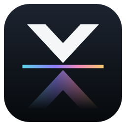
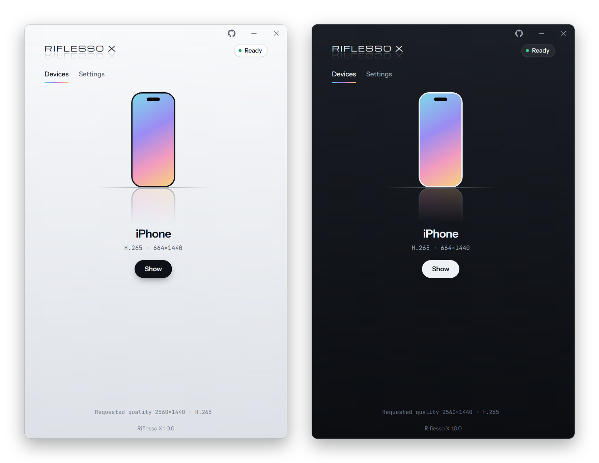
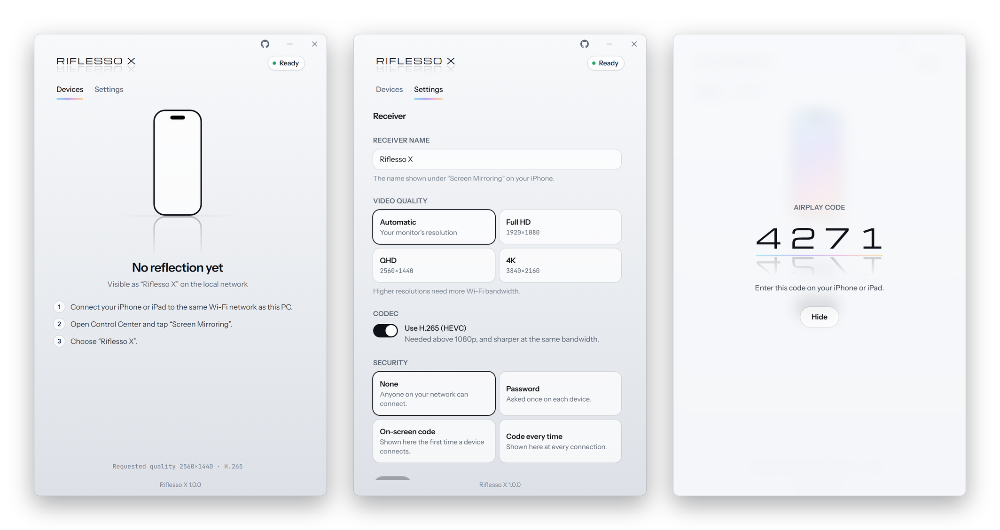

<p align="center">
  
</p>

<h1 align="center">Riflesso X</h1>

<p align="center">
  <b>Duplica lo schermo di iPhone, iPad o Mac su un PC Windows o Linux con AirPlay.</b><br>
  Libero e open source. Nitido fino al 4K, connessione immediata, leggero per il PC.
</p>

<p align="center">
  <a href="https://github.com/kannarozzi/Riflesso-X/releases/latest"></a>
  
  
  <a href="../LICENSE.md"></a>
  
  <a href="https://github.com/kannarozzi/Riflesso-X/stargazers"></a>
</p>

<p align="center">
  <a href="#download"><b>Scarica per Windows e Linux</b></a>
  &nbsp;·&nbsp;
  <a href="#come-si-usa">Come si usa</a>
  &nbsp;·&nbsp;
  <a href="#sostieni-riflesso-x">Sostieni</a>
  &nbsp;·&nbsp;
  <a href="../README.md">English</a>
</p>

<p align="center">
  
</p>

## Perché Riflesso X

- **Immagine nitida.** Fino al 4K con H.265, decodifica hardware e ridimensionamento
  sulla GPU, con NVIDIA RTX Video Super Resolution su Windows dove disponibile. I colori sono
  quelli che invia l'iPhone (full range BT.709).
- **Connessione immediata.** Tocchi *Duplica schermo*, scegli il PC e l'immagine
  compare in una frazione di secondo.
- **Anche l'audio.** Il suono del dispositivo esce dal PC, ricampionato per la tua
  scheda audio.
- **Decidi tu chi entra.** Chiunque sulla tua rete, oppure con una password o un
  codice mostrato sul PC.
- **Leggero.** Un installer da 4,5 MB su Windows, un pacchetto da 7 MB su Linux. Chiudendo la finestra l'interfaccia viene
  liberata del tutto, e se vuoi resta solo il ricevitore nell'area di notifica.
- **Ordinato.** Su Windows tutto sta in un'unica cartella: impostazioni, log e persino
  i file della web view. Disinstallando, o cancellando la cartella, non resta nulla.
- **Privato.** Niente account, telemetria o cloud. Lo stream va dal dispositivo al
  PC sulla tua rete locale e da nessun'altra parte. L'unica cosa che l'app chiede a
  internet è se c'è una versione nuova, e puoi disattivarlo.
- **Di casa sul tuo desktop.** Segue il tema chiaro o scuro, parla 10 lingue, e la
  finestra del mirroring occupa lo schermo senza finire sotto la barra delle
  applicazioni. Su Linux funziona con Wayland e X11.

## Download

Tutti i file sono nella [pagina delle release](https://github.com/kannarozzi/Riflesso-X/releases/latest),
con un file `SHA256SUMS.txt` per verificare i download.

### Windows

| | |
|---|---|
| **Installer** · `Riflesso-X_1.1.0_x64-setup.exe` | Si installa solo per il tuo utente, in un'unica cartella a tua scelta, senza diritti di amministratore. |
| **Portable** · `Riflesso-X_1.1.0_x64-portable.zip` | Estrai dove vuoi e avvia `Riflesso X.exe`. Per toglierlo, cancella la cartella. |
| **Riga di comando** · `Riflesso-X_1.1.0_x64-cli.zip` | Solo il comando `riflesso`, senza l'app. Si installa con una riga: vedi [Riga di comando](#riga-di-comando). |

**Requisiti:** Windows 10 o 11 a 64 bit, con Microsoft Edge WebView2 Runtime (già
incluso in Windows 11). Oltre 1080p serve l'estensione gratuita
[Estensioni video HEVC](https://apps.microsoft.com/detail/9n4wgh0z6vhq) dal Microsoft Store.

### Linux

| | |
|---|---|
| **Ubuntu, Debian, Mint, Pop!_OS** · `Riflesso-X_1.1.0_amd64.deb` | Aprilo con il gestore del software, oppure `sudo apt install ./Riflesso-X_1.1.0_amd64.deb`. |
| **Fedora** · `Riflesso-X_1.1.0_x86_64.rpm` | Aprilo con il gestore del software, oppure `sudo dnf install ./Riflesso-X_1.1.0_x86_64.rpm`. |
| **Riga di comando** · `Riflesso-X_1.1.0_linux-x64-cli.tar.gz` | Solo il comando `riflesso`, per qualsiasi distribuzione. Si installa con una riga: vedi [Riga di comando](#riga-di-comando). |

**Requisiti:** un PC a 64 bit con Ubuntu 22.04, Debian 12, Fedora 36 o successivi (o
un'altra distribuzione altrettanto recente). I pacchetti installano da soli ciò che
serve, GStreamer compreso. Il video è decodificato in hardware sulle schede NVIDIA
(NVDEC) e, con il driver VA-API, su Intel e AMD; altrimenti via software.

> [!NOTE]
> Riflesso X usa la firma del codice gratuita offerta da [SignPath.io](https://about.signpath.io),
> con certificato di [SignPath Foundation](https://signpath.org): vedi la
> [code signing policy](../CODE_SIGNING_POLICY.md) (in inglese). Finché non escono le release
> firmate, al primo avvio Windows SmartScreen potrebbe avvisarti: scegli
> **Ulteriori informazioni → Esegui comunque**. Puoi verificare i file con
> `SHA256SUMS.txt`, oppure compilarli tu da questo codice.

## Come si usa

1. Avvia Riflesso X. Su Windows, la prima volta, Windows Firewall chiede il permesso:
   consentilo sulle **reti private**. Su Linux, con Ubuntu e Fedora Workstation, non
   serve consentire nulla.
2. Collega iPhone, iPad o Mac alla **stessa rete Wi-Fi** del PC.
3. Apri **Centro di Controllo → Duplica schermo** e scegli **Riflesso X**.

Nella finestra del mirroring fai doppio clic o premi <kbd>F11</kbd> per lo schermo
intero, <kbd>Esc</kbd> per uscire. Chiudere la finestra interrompe la duplicazione
(oppure la nasconde soltanto, se preferisci: vedi *Impostazioni → App*).

<picture>
  <source media="(prefers-color-scheme: dark)" srcset="images/screens-dark.png">
  
</picture>

## Sicurezza

Scegli chi può duplicare lo schermo sul tuo PC in *Impostazioni → Ricevitore → Sicurezza*:

| Modalità | Cosa succede |
|---|---|
| **Nessuna** | Chiunque sulla tua rete può collegarsi. |
| **Password** | Il dispositivo chiede una password la prima volta, poi la ricorda. |
| **Codice a schermo** | Il PC mostra un codice a 4 cifre la prima volta che un dispositivo si collega; poi il dispositivo viene ricordato. |
| **Codice ogni volta** | Un codice nuovo a ogni connessione. |

Il dispositivo chiede il codice come se fosse una password. *Dimentica i dispositivi
accoppiati* fa sì che ogni dispositivo debba inserire un nuovo codice.

## Riga di comando

Preferisci il terminale? Il comando `riflesso` è lo stesso ricevitore con la stessa
finestra del mirroring, senza l'app: niente installer, niente interfaccia. Su Windows
si installa da PowerShell:

```powershell
irm https://raw.githubusercontent.com/kannarozzi/Riflesso-X/main/scripts/install.ps1 | iex
```

Scarica l'ultima release, ne verifica lo SHA-256, la installa in
`%LOCALAPPDATA%\Riflesso X CLI` e la aggiunge al PATH. Su Linux, da un terminale:

```sh
curl -fsSL https://raw.githubusercontent.com/kannarozzi/Riflesso-X/main/scripts/install.sh | sh
```

Scarica l'ultima release, ne verifica lo SHA-256 e la installa in `~/.local/bin`, senza
diritti di amministratore; se manca GStreamer, ti indica il comando che lo installa
sulla tua distribuzione. Poi, in qualsiasi terminale:

```sh
riflesso                              # riceve come "Riflesso X"
riflesso -n "Salotto" -r 1080p        # un altro nome, al massimo 1080p
riflesso --code                       # codice la prima volta che un dispositivo si collega
riflesso --password segreta           # chiede una password ai dispositivi
riflesso --hide-on-close              # chiudere la finestra non disconnette
riflesso --help                       # tutte le opzioni
```

Connessioni e codici compaiono nel terminale; <kbd>Ctrl</kbd>+<kbd>C</kbd> per uscire.
Per aggiornare basta rilanciare la stessa riga. Per toglierlo, su Windows:

```powershell
irm https://raw.githubusercontent.com/kannarozzi/Riflesso-X/main/scripts/uninstall.ps1 | iex
```

Su Linux:

```sh
rm ~/.local/bin/riflesso; rm -r ~/.local/share/riflesso-x-cli
```

## Problemi comuni

<details>
<summary><b>Riflesso X non compare in Duplica schermo</b></summary>

- Controlla che dispositivo e PC siano sulla stessa rete, e che in Windows la rete
  sia impostata come *Privata*.
- Consenti Riflesso X in Windows Firewall (*Consenti app attraverso Windows Firewall*).
- Su Linux, con un firewall più restrittivo di quello predefinito, consenti la porta
  TCP 7000, la porta UDP 5353 (ricerca dei dispositivi) e le porte TCP e UDP alte,
  che trasportano immagine e audio.
- VPN e reti Wi-Fi ospiti spesso bloccano la ricerca dei dispositivi.
- Un altro ricevitore AirPlay potrebbe usare la porta 7000: Riflesso X te lo segnala.
  Chiudi l'altro ricevitore e premi *Riprova*.
</details>

<details>
<summary><b>L'immagine non supera i 1080p</b></summary>

L'iPhone invia più di 1080 righe solo con H.265. Su Windows installa le
[Estensioni video HEVC](https://apps.microsoft.com/detail/9n4wgh0z6vhq). Su Linux serve
un decoder H.265: le schede NVIDIA ce l'hanno, Intel e AMD hanno bisogno del driver
VA-API (`intel-media-driver` o quello di Mesa), altrimenti installa `gst-libav`. Poi
verifica che *Usa H.265* sia attivo nelle *Impostazioni*.
</details>

<details>
<summary><b>Dove sono salvate le impostazioni?</b></summary>

Su Windows nella cartella `data` accanto a `Riflesso X.exe` (con l'installer,
`%LOCALAPPDATA%\Riflesso X\data`); su Linux in `~/.local/share/riflesso-x`. Cancellarla riporta l'app allo stato iniziale.
</details>

## Prossimi passi

- Linux su Flathub, per le distribuzioni che .deb e .rpm non coprono.
- Registrazione in MP4.
- Più dispositivi contemporaneamente.
- Avvio con il sistema.
- AirPlay solo audio (musica) e Google Cast.

Idee e preferenze sono benvenute nelle [issue](https://github.com/kannarozzi/Riflesso-X/issues).

## Compilare dal codice

```sh
npm install
npm run tauri dev     # avvio con ricaricamento a caldo
npm run release       # Windows: installer e zip; Linux: .deb, .rpm e riga di comando
```

Servono Rust, Node.js e un compilatore C: su Windows la toolchain MSVC con i Visual
Studio C++ Build Tools, su Linux i pacchetti di sviluppo di GStreamer e WebKitGTK. I dettagli
sono in [docs/DEVELOPMENT.md](DEVELOPMENT.md), il funzionamento di AirPlay in
[docs/PROTOCOL.md](PROTOCOL.md) (in inglese).

## Sostieni Riflesso X

Riflesso X è gratuito, open source e lo sviluppo nel mio tempo libero. Se ti è utile,
due cose aiutano molto:

- **Una stella su GitHub**: ti costa un clic e aiuta altre persone a trovare il progetto.
- **Un caffè su Ko-fi**: sostiene il lavoro, dalle nuove funzioni a Flathub.

<p align="center">
  <a href="https://github.com/kannarozzi/Riflesso-X/stargazers"></a>
  &nbsp;
  <a href="https://ko-fi.com/kannarozzi"></a>
</p>

## Contribuire

Segnalazioni, traduzioni e pull request sono benvenute: vedi
[CONTRIBUTING.md](../.github/CONTRIBUTING.md).

## Ringraziamenti

Riflesso X poggia sul lavoro della comunità open source di AirPlay:

- [UxPlay](https://github.com/FDH2/UxPlay) e [RPiPlay](https://github.com/FD-/RPiPlay):
  il riferimento per il protocollo di duplicazione dello schermo.
- [playfair](https://github.com/EstebanKubata/playfair): decifratura delle chiavi
  FairPlay (incluso in `crates/playfair`).
- [shairplay](https://github.com/juhovh/shairplay): da dove è partita gran parte di
  queste conoscenze.
- [rusty_aac](https://crates.io/crates/rusty_aac): decodifica audio AAC-ELD in Rust.
- [Tauri](https://tauri.app), [React](https://react.dev) e
  [Tailwind CSS](https://tailwindcss.com) per l'interfaccia.

## Licenza

Riflesso X è software libero sotto la [GNU General Public License v3.0 o successiva](../LICENSE.md).
Puoi usarlo, studiarlo, modificarlo e condividerlo; se distribuisci una versione
modificata, deve restare sotto la stessa licenza.

AirPlay, iPhone, iPad e Mac sono marchi di Apple Inc. Riflesso X è un progetto
indipendente, non affiliato né approvato da Apple.
